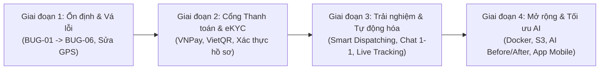

# BÁO CÁO TỔNG HỢP BUG & ĐỀ XUẤT TÍNH NĂNG MỚI (DabClean)
**Mã tài liệu:** `REPORT-BUG-FEATURE-2026-11`  
**Dự án:** DabClean — Nền tảng dịch vụ vệ sinh và chăm sóc gia đình
**Phạm vi rà soát:** Toàn bộ hệ thống (Frontend, Backend API, Database, Authentication & RBAC, AI Module, Realtime & Navigation, Test Suites)  
**Thời điểm thực hiện:** Tháng 11/2026  

---

## MỤC LỤC
1. [TỔNG QUAN HIỆN TRẠNG HỆ THỐNG](#1-tổng-quan-hiện-trạng-hệ-thống)
2. [GOM CÁC BUG & LỖ HỔNG ĐÃ PHÁT HIỆN](#2-gom-các-bug--lỗ-hổng-đã-phát-hiện)
   - 2.1. Nhóm Bug Critical & High (Bảo mật, Dữ liệu, Startup, Tiền tệ)
   - 2.2. Nhóm Bug Medium (Booking, GPS & Geocoding, Test Suites)
   - 2.3. Nhóm Bug Low / UI & Trải nghiệm (Giao diện, i18n, Đồng bộ đa trang)
   - 2.4. Bảng tổng hợp đối soát trạng thái Bug
3. [DANH SÁCH NHỮNG TÍNH NĂNG CẦN BỔ SUNG & NÂNG CẤP](#3-danh-sách-những-tính-năng-cần-bổ-sung--nâng-cấp)
   - 3.1. Phân hệ Khách hàng (Customer Experience)
   - 3.2. Phân hệ Nhân viên & Đối tác (Staff & Partner Portal)
   - 3.3. Phân hệ Quản trị viên (Admin & Operations)
   - 3.4. Nâng cấp Mô-đun AI & Thị giác máy tính (AI V3.2 / V4)
   - 3.5. Hạ tầng, DevOps & Bảo mật Nâng cao
4. [LỘ TRÌNH TRIỂN KHAI ĐỀ XUẤT (ROADMAP)](#4-lộ-trình-triển-khai-đề-xuất-roadmap)
5. [KẾT QUẢ KIỂM THỬ THỰC TẾ & GHI CHÚ KỸ THUẬT](#5-kết-quả-kiểm-thử-thực-tế--ghi-chú-kỹ-thuật)

---

## 1. TỔNG QUAN HIỆN TRẠNG HỆ THỐNG

Dự án **DabClean** đã hoàn tất một số khối tính năng quan trọng sau đợt Big Update:
- **Core Business:** Dịch vụ dọn dẹp theo giờ, định kỳ, chăm sóc gia đình (trẻ nhỏ, người cao tuổi, người bệnh) và vệ sinh công nghiệp sau xây dựng (tính theo $m^2$).
- **Ví & Tài chính:** Tách bạch hệ thống 2 ví cho nhân viên (Ví Tín Dụng ký quỹ chiết khấu và Ví Thu Nhập rút tiền), sổ cái 2 dòng (Double-entry ledger), thanh toán và hoàn tiền qua ví.
- **Bản đồ & Định vị:** Tích hợp CARTO tiles, ArcGIS Geocoding và chỉ dẫn định vị dành cho thợ.
- **AI Phân tích phòng:** Hỗ trợ model MobileNet chuyển giao (V2: 3 mức độ bẩn) và thử nghiệm CLIP / VLM Ollama (V3.1: 6 tiêu chí).
- **Chế độ Demo (Demo Mode):** Hỗ trợ mock In-Memory phục vụ thẩm định nhanh mà không cần máy chủ MySQL ngoại vi.

Tuy nhiên, qua audit mã nguồn và chạy các bộ test hồi quy thực tế, hệ thống vẫn tồn tại nhiều điểm nghẽn kỹ thuật, test suite chưa đồng bộ và các tính năng còn thiếu cần bổ sung để sẵn sàng thương mại hóa thực tế.

---

## 2. GOM CÁC BUG & LỖ HỔNG ĐÃ PHÁT HIỆN

### 2.1. Nhóm Bug Critical & High (Bảo mật, Dữ liệu, Startup, Tiền tệ)

#### BUG-01: Cửa sổ bất đồng bộ (Race Condition) khi khởi động Server Backend
- **Vị trí:** `backend/server.js` và `backend/src/config/db.js`
- **Hiện tượng:** `server.js` gọi `app.listen()` ngay lập tức mà không `await` quá trình `initDatabase()` trong `db.js`.
- **Hậu quả:** Trong môi trường Production với MySQL có độ trễ kết nối, các request HTTP đầu tiên (như gọi login, get services) sẽ đâm vào DB trước khi bảng, cột migration và connection pool kịp sẵn sàng, dẫn đến lỗi crash 500 hoặc truy vấn thất bại.
- **Giải pháp:** Bọc quá trình khởi tạo server trong hàm async `startServer()`, đợi `await db.initDatabase()` thành công rồi mới mở cổng `server.listen()`.

#### BUG-02: Cơ chế tự động fallback In-Memory vi phạm nguyên tắc Production
- **Vị trí:** `backend/src/config/db.js`
- **Hiện tượng:** Khi kết nối MySQL thất bại, console in cảnh báo nhưng ngầm kích hoạt in-memory fallback nếu không cấu hình chặt chẽ biến môi trường.
- **Hậu quả:** Vi phạm nghiêm trọng quy chuẩn kỹ thuật (AGENTS.md Section II). Dữ liệu khách hàng thanh toán và nạp ví có nguy cơ bị lưu vào RAM và mất trắng khi server bị restart trên production.
- **Giải pháp:** Cần kiểm tra biến `NODE_ENV === 'production'`. Nếu kết nối DB thất bại ở production, lập tức kích hoạt `process.exit(1)` với thông báo rõ ràng, chỉ cho phép demo fallback khi bật tường minh cờ `DEMO_MODE=true` hoặc `ALLOW_IN_MEMORY_FALLBACK=true`.

#### BUG-03: Rủi ro Race Condition khi duyệt chiết khấu/hủy ca với DB In-Memory
- **Vị trí:** `backend/src/controllers/staffController.js` (Hàm `cancelAcceptedTask`)
- **Hiện tượng:** Khi thợ hủy ca, nếu hệ thống đang ở chế độ mock in-memory, câu lệnh log hoàn tiền chiết khấu báo lỗi: *"Hệ thống cơ sở dữ liệu hiện không khả dụng để xử lý hoàn tiền chiết khấu."*
- **Hậu quả:** Giao dịch hoàn tiền cho thợ bị ngắt quãng giữa chừng, trạng thái đơn đổi về `pending` nhưng ví thợ chưa được hoàn cọc.
- **Giải pháp:** Đồng bộ hóa repository pattern để bộ giả lập InMemory hỗ trợ đầy đủ các hàm ledger/refund tương thích 100% với MySQL transaction.

---

### 2.2. Nhóm Bug Medium (Booking, GPS & Geocoding, Test Suites)

#### BUG-04: Test Suite `test-booking-location.js` bị lệch Schema và Controller validation
- **Vị trí:** `backend/test-booking-location.js` vs `backend/src/models/bookingModel.js` & `backend/src/controllers/bookingController.js`
- **Hiện tượng:**
  1. `test-booking-location.js` mong đợi `bookingModel.create` chèn thêm 3 cột `latitude, longitude, location_accuracy` vào câu lệnh `INSERT INTO bookings`. Tuy nhiên `bookingModel.js` phiên bản hiện tại chưa có 3 cột này trong query INSERT.
  2. Test gọi `controller.createBooking` với tọa độ lỗi để mong đợi HTTP 400, nhưng `bookingController.js` chưa gọi middleware `validateBookingLocation` ở đầu hàm `createBooking`.
- **Hậu quả:** Chạy `node backend/test-booking-location.js` bị FAIL 2/6 ca kiểm thử. Tọa độ GPS từ frontend gửi lên có thể bị bỏ qua hoặc không lưu vào bản ghi đơn hàng.
- **Giải pháp:**
  - Bổ sung 3 trường `latitude`, `longitude`, `location_accuracy` vào `bookingModel.create` (cả câu lệnh SQL và danh sách tham số).
  - Thêm bước tiền kiểm `validateBookingLocation(req.body)` tại `bookingController.js:createBooking`.

#### BUG-05: Thiếu dependency `linkedom` ở `ai-module` làm gãy Unit Test
- **Vị trí:** `ai-module/test/care-booking-auth.test.cjs`, `ai-module/test/staff-navigation.test.cjs`
- **Hiện tượng:** Chạy test trên môi trường độc lập báo lỗi `Cannot find module 'linkedom'`.
- **Hậu quả:** Không thể chạy tự động CI/CD cho các file test DOM giả lập của module AI.
- **Giải pháp:** Cập nhật `ai-module/package.json` bổ sung `"devDependencies": { "linkedom": "^0.18.5" }` và chạy `npm i --save-dev linkedom`.

#### BUG-06: Các Integration Test gốc phụ thuộc vào việc server đã chạy sẵn cổng 5000
- **Vị trí:** `backend/test-14-bugs-verify.js`, `test-wallet-system.js`, `test-care-redesign.js`, `test-post-construction.js`...
- **Hiện tượng:** Khi chạy trực tiếp bằng `node <file>`, test ném lỗi `AggregateError [ECONNREFUSED] ::1:5000` nếu lập trình viên quên chạy `npm start` ở một terminal riêng biệt.
- **Giải pháp:** Bổ sung helper tự động spawn server ngầm trong lifecycle `beforeAll()` hoặc `before()` của file test nếu phát hiện cổng 5000 chưa mở, và tự đóng khi test hoàn tất.

---

### 2.3. Nhóm Bug Low / UI & Trải nghiệm (Giao diện, i18n, Đồng bộ đa trang)

#### BUG-07: Đồng bộ hóa định vị bản đồ khi thay đổi địa chỉ chữ (Text Address)
- **Vị trí:** `frontend/js/booking-location.js`, `frontend/booking.html`
- **Hiện tượng:** Khi người dùng chọn ghim vị trí qua bản đồ GPS, sau đó sửa lại số nhà trong ô input text, trạng thái ghim vị trí chưa tự động reset cờ xác nhận hoặc geocode lại, dễ gây bất nhất giữa địa chỉ chữ và tọa độ GPS lưu về hệ thống.
- **Giải pháp:** Bổ sung lắng nghe sự kiện `input` trên trường địa chỉ để xóa tọa độ cũ và kích hoạt debounce gợi ý lại vị trí tương ứng.

#### BUG-08: Tên thương hiệu chưa nhất quán trong giao diện
- **Vị trí:** Một số thẻ email mẫu, footer và thông báo pop-up từng sử dụng nhiều tên thương hiệu.
- **Giải pháp:** Đưa tên hiển thị về một biến cấu hình duy nhất ở frontend `APP_BRAND_NAME = "DabClean"` để đảm bảo tính nhất quán của bộ nhận diện thương hiệu.

---

### 2.4. Bảng tổng hợp đối soát trạng thái Bug

| Mã Bug | Tên Bug / Khiếm khuyết | Mức độ | Vị trí chính | Đề xuất khắc phục |
| :---: | :--- | :---: | :--- | :--- |
| **BUG-01** | Bất đồng bộ khi khởi động server trước DB | **CRITICAL** | `backend/server.js` | Dùng `async startServer()` đợi `initDatabase` |
| **BUG-02** | Fallback InMemory tự động trong Production | **CRITICAL** | `backend/src/config/db.js` | Chặn đứng bằng `process.exit(1)` khi chạy prod |
| **BUG-03** | Thiếu mock hoàn cọc trong InMemory DB | **HIGH** | `backend/src/controllers/staffController.js` | Đồng bộ logic hoàn ví trong DB mock |
| **BUG-04** | Lệch GPS Schema & thiếu kiểm tra tọa độ | **MEDIUM** | `bookingModel.js`, `bookingController.js` | Thêm 3 cột GPS vào model & validate ở controller |
| **BUG-05** | Thiếu thư viện `linkedom` ở `ai-module` | **MEDIUM** | `ai-module/package.json` | Cài đặt `linkedom` vào `devDependencies` |
| **BUG-06** | Test ném `ECONNREFUSED` vì thiếu auto-spawn | **MEDIUM** | Các file `test-*.js` | Bổ sung pre-test check server runner |
| **BUG-07** | Lệch tọa độ khi sửa ô nhập địa chỉ | **LOW** | `frontend/js/booking-location.js` | Bắt sự kiện text input để invalidate tọa độ cũ |
| **BUG-08** | Tên thương hiệu chưa nhất quán | **LOW** | Frontend HTML / JS | Quy chuẩn qua hằng số `APP_BRAND_NAME` |

---

## 3. DANH SÁCH NHỮNG TÍNH NĂNG CẦN BỔ SUNG & NÂNG CẤP

Để DabClean phát triển từ một phiên bản thử nghiệm nghiệp vụ thành một nền tảng vận hành quy mô lớn, dưới đây là các tính năng thiết yếu cần bổ sung chia theo từng phân hệ:

---

### 3.1. Phân hệ Khách hàng (Customer Experience)

1. **Tích hợp Cổng thanh toán Trực tuyến Thực tế (VNPay, MoMo, ZaloPay, VietQR PRO):**
   - *Hiện trạng:* Hệ thống hiện chỉ hỗ trợ Tiền mặt (Cash), Ví nội bộ (DabClean Wallet) và Mock Sandbox.
   - *Tính năng mới:* Tích hợp Webhook & IPN tự động từ VNPay / VietQR. Khi khách hàng quét mã QR ngân hàng hoặc thanh toán MoMo, hệ thống tự động đối soát trong transaction, đổi trạng thái đơn sang `paid` và kích hoạt phân ca realtime cho thợ.

2. **Hệ thống Đăng ký & Tích điểm Thành viên (Loyalty & Gamification):**
   - *Tính năng mới:* Khách hàng tích điểm sau mỗi đơn hoàn thành (10.000 VNĐ = 1 điểm). Các hạng mức thành viên: *Bạc (Silver), Vàng (Gold), Bạch Kim (Platinum)* với quyền lợi tự động giảm 5% - 10% cho các lần đặt tiếp theo.

3. **Chọn Nhân viên Yêu thích & Đặt lịch lặp lại theo tuần (Recurring Booking Pro):**
   - *Tính năng mới:* Khách hàng có thể lưu thợ quen đã từng dọn tốt (dựa trên đánh giá 5 sao). Đơn hàng định kỳ sẽ ưu tiên chuyển ca cho thợ quen trước khi mở nhận tự do.

4. **Trò chuyện Trực tiếp (Live Chat 1-1 Khách hàng & Thợ):**
   - *Hiện trạng:* Chỉ có cuộc gọi điện thoại thoại thông thường.
   - *Tính năng mới:* Kênh chat realtime bảo mật qua Socket.IO (chỉ mở khi đơn ở trạng thái `confirmed` / `arrived` / `in_progress`), cho phép gửi ảnh vị trí cửa nhà hoặc lưu ý dọn dẹp cụ thể.

---

### 3.2. Phân hệ Nhân viên & Đối tác (Staff & Partner Portal)

1. **Định vị Thời gian Thực & Bắt đầu Di chuyển (Live Tracking GPS):**
   - *Hiện trạng:* Thợ nhấn "Đã đến nơi" theo một nút bấm thủ công.
   - *Tính năng mới:* Thợ bấm "Bắt đầu di chuyển", hệ thống truyền tọa độ GPS thời gian thực lên bản đồ của khách hàng (giống Grab / Be) và tính toán thời gian dự kiến đến (ETA).

2. **Chữ ký Điện tử & Biên bản Nghiệm thu Số (E-Signature & Digital Sign-off):**
   - *Tính năng mới:* Đối với dịch vụ dọn sau xây dựng hoặc trông người già/người ốm, nhân viên cung cấp màn hình ký tên xác nhận nghiệm thu số (Canvas signature) trên điện thoại cho chủ nhà trước khi bấm Hoàn thành ca.

3. **Hệ thống Ca linh hoạt & Tự động Phân ca theo Bán kính (Smart Dispatching):**
   - *Hiện trạng:* Thợ xem danh sách việc chung và tự bấm nhận ca (First-come, first-served).
   - *Tính năng mới:* Hệ thống tính toán khoảng cách Haversine từ vị trí thợ đến nhà khách; ưu tiên thông báo nổ cuốc cho thợ trong bán kính 3km trước, sau 5 phút không ai nhận mới mở bán kính rộng hơn.

---

### 3.3. Phân hệ Quản trị viên (Admin & Operations)

1. **Bộ lọc Báo cáo Chuyên sâu & Xuất dữ liệu (Excel/PDF Export):**
   - *Tính năng mới:* Cho phép kế toán và admin xuất file Excel báo cáo doanh thu, sao kê sổ cái ví, danh sách hoa hồng nhân viên theo từng tháng/quý để phục vụ quyết toán thuế và bảng lương.

2. **Quản lý Hợp đồng Đối tác & Xác thực Danh tính (eKYC CCCD/CMND):**
   - *Tính năng mới:* Tự động quét và trích xuất OCR thông tin từ Căn cước công dân của thợ đăng ký làm đối tác; tích hợp chữ ký hợp đồng bảo mật lao động trực tuyến.

3. **Trung tâm Xử lý Khiếu nại & Tranh chấp (Dispute & Incident Management):**
   - *Tính năng mới:* Tạo ticket khiếu nại (đồ đạc bị vỡ, làm chưa sạch, thợ đến muộn). Admin có công cụ đóng băng thù lao đơn hàng, xem lại ảnh Trước/Sau (Job Photos) của thợ và hoàn tiền một phần hoặc toàn phần cho khách hàng trực tiếp từ Dashboard.

---

### 3.4. Nâng cấp Mô-đun AI & Thị giác máy tính (AI V3.2 / V4)

1. **Tối ưu hóa Tốc độ Mô hình Phân tích Phòng V3.1:**
   - *Hiện trạng:* Model VLM Ollama mất ~39.7s khi chạy suy luận trên CPU.
   - *Tính năng mới:* Chuyển đổi mô hình nhẹ hơn (ONNX Runtime, MobileNet-V4 hoặc YOLOv8-Nano) kết hợp Quantization INT8 để thời gian phân tích phòng giảm xuống dưới 2 giây ngay trên trình duyệt hoặc server CPU thông thường.

2. **Tự động So sánh Ảnh Trước và Sau dọn dẹp (Before/After Quality Assurance):**
   - *Tính năng mới:* So khớp góc chụp và phân tích độ sai khác (Image Difference & Cleanliness Score Verification) giữa ảnh chụp lúc thợ đến và ảnh chụp khi dọn xong để xác nhận phòng đã đạt chuẩn sạch trước khi giải ngân thù lao.

---

### 3.5. Hạ tầng, DevOps & Bảo mật Nâng cao

1. **Container hóa toàn diện (Docker & Docker Compose Chuẩn):**
   - Thiết lập `docker-compose.yml` gồm 3 container riêng biệt: `backend-api`, `ai-module`, `mysql-db` với cấu hình volume lưu trữ ảnh upload (`uploads/job-photos`), giúp một lệnh `docker-compose up -d` là chạy hoàn chỉnh mọi dịch vụ.

2. **Cơ chế Lưu trữ Ảnh Đám mây (AWS S3 / Cloudflare R2 / Google Cloud Storage):**
   - *Hiện trạng:* Ảnh dọn phòng lưu trên ổ đĩa cục bộ server (`uploads/`).
   - *Tính năng mới:* Lưu trữ ảnh lên Cloud Object Storage có chữ ký URL tạm thời, giảm tải ổ cứng server và tăng tính bảo mật cho ảnh riêng tư trong nhà khách hàng.

3. **Ghi Log Tập trung & Cảnh báo Sự cố (Winston, Sentry & APM):**
   - Theo dõi lỗi 500 thời gian thực, gửi cảnh báo Telegram/Slack khi phát hiện cuộc tấn công brute-force mật khẩu hoặc giao dịch ví bất thường.

---

## 4. LỘ TRÌNH TRIỂN KHAI ĐỀ XUẤT (ROADMAP)

- **Sprint 1 (Ngay lập tức - 1 tuần):** Sửa lỗi bất đồng bộ khởi động `server.js`, bổ sung 3 cột GPS vào `bookingModel` & `bookingController`, sửa `ai-module/package.json` (thêm `linkedom`), và đồng bộ cơ chế chống fallback ngầm trong production.
- **Sprint 2 (2 - 3 tuần):** Tích hợp cổng thanh toán VietQR / VNPay tự động; tích hợp xuất báo cáo Excel cho kế toán ở Dashboard Admin.
- **Sprint 3 (3 - 4 tuần):** Triển khai Live GPS Tracking thợ di chuyển, Module khiếu nại (Dispute Management) và Chat Socket.IO nội bộ.
- **Sprint 4 (1 - 2 tháng):** Đóng gói Docker, chuyển lưu trữ ảnh lên S3/R2 và tối ưu hóa thời gian suy luận AI dưới 2s.

---

## 5. KẾT QUẢ KIỂM THỬ THỰC TẾ & GHI CHÚ KỸ THUẬT

Dưới đây là các kết quả kiểm thử đã được chạy và xác minh trực tiếp trên môi trường máy chủ:
- **`backend/test-server-demo-default.js`:** **PASS** (7/7 cấu hình khởi động, từ chối demo trong production).
- **`backend/test-care-booking.js`:** **PASS** (9/9 kịch bản xác thực JWT, tạo 3 gói dịch vụ chăm sóc, chặn guest/token hết hạn).
- **`backend/test-demo-mode.js`:** **PASS** (20/20 ca test HTTP, tranh chấp nhận đơn của thợ, idempotent acceptance).
- **`backend/test-staff-navigation.js`:** **PASS** (17/17 kịch bản điều hướng chỉ đường, phân quyền staff).
- **`backend/test-map-search.js` & `test-map-ui.js`:** **PASS** (9/9 ca kiểm tra ArcGIS Geocoding, fallback địa chỉ Việt Nam, chống trôi ghim bản đồ).
- **`test-homepage-verify.js`:** **PASS** (22/22 tiêu chí giao diện trang chủ, bảng giá, disclaimer chăm sóc).
- **`test-english-coverage.js`:** **PASS** (100% độ bao phủ song ngữ tiếng Anh cho 326 data-i18n keys).
- **`backend/test-booking-location.js`:** **FAIL 2/6 ca** (Nguyên nhân: `bookingModel.js` và `bookingController.js` chưa tích hợp 3 tham số GPS như bộ test yêu cầu - Đã đưa vào `BUG-04` để xử lý).

---
*Báo cáo được khởi tạo và lưu trữ phục vụ tài liệu kỹ thuật phát triển DabClean.*
